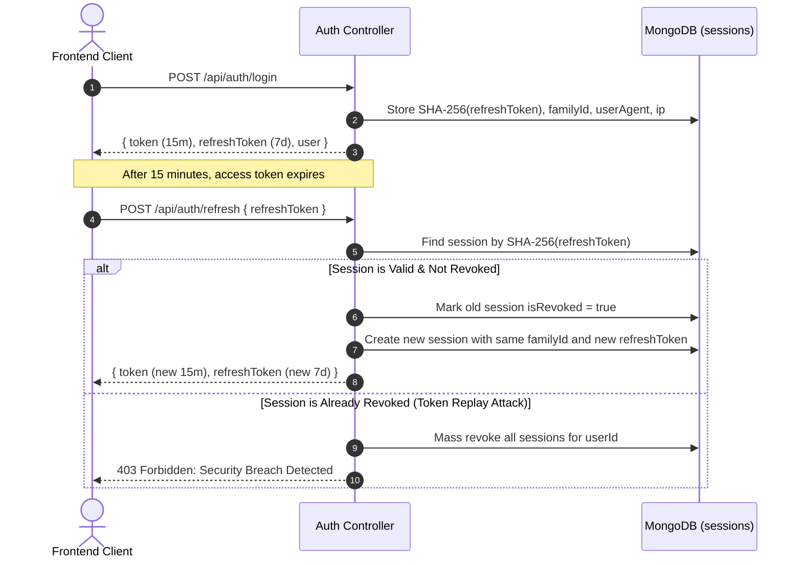

# FLOXA WORK — SESSION MANAGEMENT ARCHITECTURE

**Version:** 2.0 (Hardened Production)  
**Target:** Enterprise Multi-Device Session Tracking & Token Rotation

---

## 1. Overview & Data Architecture

Session state is persisted in MongoDB via the `sessions` collection (`Session.model.ts`). Refresh tokens are never stored in plain text; only their cryptographic SHA-256 digests are stored in the database.

```
+-------------------------------------------------------------+
|                       Session Schema                        |
+-------------------------------------------------------------+
| userId           : ObjectId (ref: User, indexed)            |
| familyId         : String (UUID v4, indexed)                |
| refreshTokenHash : String (SHA-256 64-char hex, indexed)   |
| userAgent        : String (Browser / Client identifier)     |
| ipAddress        : String (Client IP address)               |
| isRevoked        : Boolean (Default: false, indexed)        |
| expiresAt        : Date (TTL Index: auto-deletes expired)   |
| lastActiveAt     : Date (Default: Date.now)                 |
+-------------------------------------------------------------+
```

### TTL Automatic Eviction
MongoDB native TTL index is configured on `expiresAt`:
```typescript
expiresAt: { type: Date, required: true, index: { expires: 0 } }
```
Expired sessions are automatically garbage-collected by the MongoDB engine without manual cron maintenance.

---

## 2. Token Lifecycle & Rotation Sequence



---

## 3. Replay Protection & Breach Remediation

If an attacker steals a previously used refresh token and attempts to submit it to `POST /api/auth/refresh`:
1. The backend hashes the incoming token.
2. It locates the matching session record in MongoDB.
3. It detects that `isRevoked === true`.
4. The system flags an active replay attack.
5. All sessions associated with `existingSession.userId` are immediately set to `isRevoked: true`.
6. An immutable audit record with action `AUTH_TOKEN_REUSE_DETECTED` is written to `audit_logs`.
7. The attacker receives an explicit HTTP 403 Forbidden response.
8. The legitimate user is prompted to re-authenticate on all devices, completely severing attacker access.
