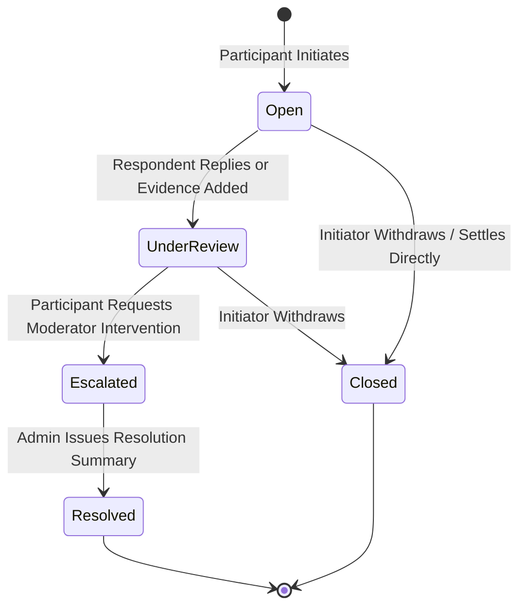

# FLOXA WORK — DISPUTE RESOLUTION WORKFLOW
## Non-Custodial Direct Mediation, Evidence Evaluation & Status Lifecycle

**Version:** 1.0.0  
**Date:** 14 November 2026  
**Status:** Production Standard  

---

## 1. Absolute Business Invariant — Non-Custodial Mediation

```
FLOXA WORK DOES NOT ACT AS AN ESCROW AGENT, FINANCIAL ARBITRATOR, OR PAYMENT CUSTODIAN.
```

Disputes on FLOXA Work exist to:
1. Provide an authoritative platform record of deliverable quality, scope disagreements, and timelines.
2. Provide mediated communication threads between client and freelancer.
3. Allow platform operations to inspect evidence files, chat logs, and milestone submissions.
4. Issue documented findings, conduct sanctions, or account status updates.

Dispute resolution **NEVER** processes monetary refunds, payment reversals, or fund disbursals, because all payments occur externally via direct bank, UPI, or external merchant channels.

---

## 2. Dispute Categories

A dispute must declare one of seven supported categories:
1. `deliverable_quality`: Substandard work, incomplete assets, failure to meet agreed specification.
2. `scope_disagreement`: Out-of-scope demands, creeping requirements, or unagreed additions.
3. `missed_deadlines`: Severe delivery delays without agreed timeline extensions.
4. `communication_conduct`: Abusive language, unresponsiveness, or unprofessional behavior.
5. `payment_disagreement`: Missing direct payment confirmations, external UTR discrepancies.
6. `commitment_breach`: Non-compliance with Master Services Agreement clauses.
7. `other`: Uncategorized operational disagreements.

---

## 3. Dispute Lifecycle



---

## 4. Confidential Internal Moderator Notes

- When a moderator or admin inspects a dispute, they can record internal notes (`isInternalModeratorNote = true`).
- **Security Barrier:** The endpoint `GET /api/disputes/:disputeId` explicitly filters out internal moderator notes for regular participants.
- Regular participants never receive internal moderator discussions, ensuring objective, unbiased administrative deliberation.
