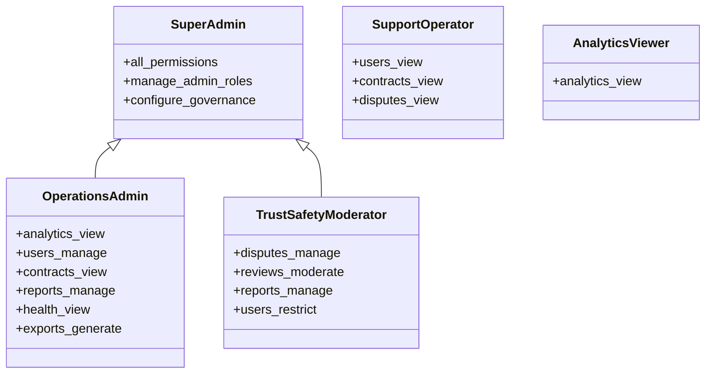

# FLOXA WORK — PHASE 12 AUDIT & ARCHITECTURE PLAN
## Admin Operations, Platform Analytics, Governance & Business Intelligence

**Document Version:** 1.0.0  
**Date:** 14 November 2026  
**Status:** In Progress / Active Execution  
**Target Milestone:** Phase 12 Production Delivery  

---

## 1. Executive Summary

Phase 12 builds an enterprise-grade administrative command center and business intelligence system for FLOXA Work. The implementation enables authorized platform operators to inspect real-time marketplace dynamics, track project operational risks, enforce trust and safety standards, audit privileged actions, monitor technical infrastructure, and generate secure exports—without compromising the platform's non-custodial direct billing architecture.

---

## 2. Invariant: Separation of Marketplace Contractual Values vs User-Reported External Payments

FLOXA Work is permanently **NOT** an escrow custodian, wallet provider, or payment intermediary:
1. **Contractual Project Values:** Represent legal contract scopes negotiated between clients and freelancers (`Contract.totalBudget`). This is **NOT** platform revenue or cash held in custody.
2. **User-Reported External Payments:** Represent direct settlement transactions reported by users (`PaymentRecord.amount` with UTR/bank references). These are self-reported external transfers, not processed by FLOXA.
3. **Company Revenue:** Must **NEVER** be calculated from or confused with project contract values or external payment acknowledgments.

---

## 3. Current State & Gap Analysis

| Area | Current State (Pre-Phase 12) | Phase 12 Production Implementation |
| :--- | :--- | :--- |
| **Admin Authorization** | Binary `user.role === 'admin'`. No sub-roles or granular permissions. | Hierarchical 5-tier role model (`super_admin`, `operations_admin`, `trust_safety_moderator`, `support_operator`, `analytics_viewer`) with server-side permission checks. |
| **Executive Analytics** | Basic static counters (`countDocuments`) without time slicing or trend aggregation. | Real-time MongoDB aggregation pipelines supporting dynamic timeframes (Today, 7D, 30D, 90D, Custom) across users, briefs, proposals, contracts, disputes, and reviews. |
| **Marketplace Health** | Missing conversion, acceptance, and delivery velocity metrics. | Dual-sided performance metrics: Client conversion funnels (briefs → proposals → contracts) and Freelancer discovery & win-rates. |
| **Contract Operations** | No centralized project risk view. | Filterable contract pipeline tracking approaching deadlines, overdue milestones, blocked tasks, and closeout statuses. |
| **User Administration** | Simple KYC verification toggle. | Complete lifecycle management: search, filters, safety history, suspension, reinstatement, communication restrictions, and audit tracking. |
| **Audit Log Explorer** | Raw collection in database, no UI or filtering API. | Full-text and faceted search by actor, action category, target type, and date range. Immutable & read-only. |
| **System Health** | Generic health endpoint returning `{ status: 'ok' }`. | Deep diagnostics: database latency, memory metrics, process uptime, WebSocket clients, and storage reachability without revealing credentials. |
| **Operational Exports** | None. | Safe CSV exports with formula injection defense (`=,+,-,@,\t,\r` sanitization), pagination limits, and non-custodial disclaimers. |
| **Admin Portal UI** | Basic tables with manual state. | Tabbed modular command center in `AdminPortal.tsx` with metrics cards, filters, interactive tables, and confirmation dialogs. |

---

## 4. Administrative Role & Permission Matrix

### Detailed Permission Matrix:

| Permission | Super Admin | Operations Admin | Trust & Safety Moderator | Support Operator | Analytics Viewer |
| :--- | :---: | :---: | :---: | :---: | :---: |
| `analytics:view` | **YES** | **YES** | NO | NO | **YES** |
| `users:view` | **YES** | **YES** | NO | **YES** | NO |
| `users:manage` | **YES** | **YES** | NO | NO | NO |
| `contracts:view` | **YES** | **YES** | NO | **YES** | NO |
| `disputes:manage` | **YES** | **YES** | **YES** | NO | NO |
| `reviews:moderate` | **YES** | NO | **YES** | NO | NO |
| `reports:manage` | **YES** | **YES** | **YES** | NO | NO |
| `audit:view` | **YES** | **YES** | NO | NO | NO |
| `health:view` | **YES** | **YES** | NO | NO | NO |
| `exports:generate` | **YES** | **YES** | NO | NO | NO |
| `roles:manage` | **YES** | NO | NO | NO | NO |

---

## 5. Security & Privacy Controls

1. **Privilege Escalation Prevention:** Only `super_admin` can modify user administrative roles or assign permissions. Attempted modifications by other roles are rejected with HTTP `403 Forbidden`.
2. **Credential Redaction:** Administrative user APIs strictly project out `passwordHash`, `emailVerificationTokenHash`, `passwordResetTokenHash`, and refresh token hashes.
3. **Internal Note Secrecy:** Private moderator deliberations remain inaccessible to ordinary participants and support operators.
4. **Formula Injection Defense:** CSV exports escape initial characters (`=`, `+`, `-`, `@`, `\t`, `\r`) with single-quote prefixes to eliminate Excel/Sheets DDE exploits.
5. **Immutable Audit Logs:** Audit logs can never be updated or deleted through any administrative endpoint.

---

## 6. Implementation Roadmap

1. **Step 1:** Extend `User.model.ts` with `adminRole`, `status`, and `restrictions`.
2. **Step 2:** Implement `admin.middleware.ts` for granular role and permission checks.
3. **Step 3:** Implement analytics aggregation pipelines in `admin.controller.ts` (Overview, Marketplace, Projects, Trust & Safety).
4. **Step 4:** Implement operational endpoints: User management (search, suspend, reinstate, restrictions), Contract operations, Audit Log explorer, System Health.
5. **Step 5:** Implement secure CSV export engine with sanitization and non-custodial disclosures.
6. **Step 6:** Mount routes in `backend/src/routes/index.ts`.
7. **Step 7:** Upgrade `frontend/lib/api.ts` and `frontend/components/AdminPortal.tsx`.
8. **Step 8:** Create and execute automated test suite `backend/tests/phase12_admin_analytics_governance.test.cjs` covering all 31+ requirements and full regression suites.
9. **Step 9:** Execute builds and runtime daemon validation.
10. **Step 10:** Generate complete documentation in `floxa work/docs/`.
11. **Step 11:** Commit Git checkpoint.

