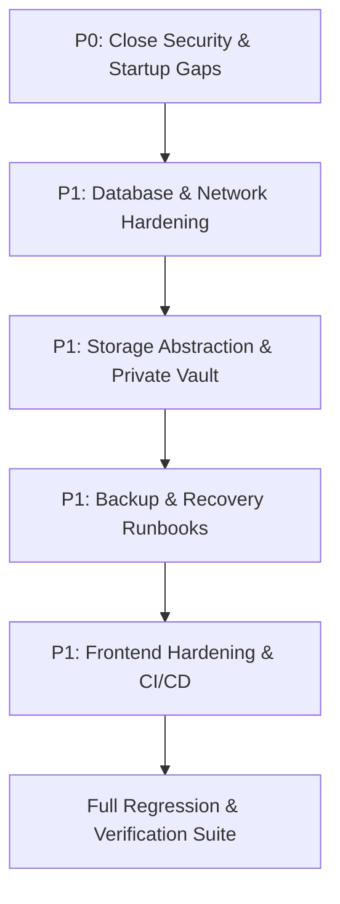

# FLOXA Work — Phase 13 Production Readiness Audit

**Project:** FLOXA Work  
**Phase:** 13 — Production Deployment, Infrastructure Hardening & Launch Readiness  
**Target:** Commercial Production Readiness  
**Architecture:** Next.js 16.2 (Turbopack) + React 19 + Express 4.21 + MongoDB 8.x / Mongoose 8.x + TypeScript 5.7  
**Date:** 14 November 2026  
**Auditor:** Principal Software Architect & Lead Security Engineer  

---

## 1. Executive Summary

A comprehensive architectural, security, reliability, and deployment audit of the FLOXA Work codebase was performed following the completion of Phase 12 (Admin Operations, Platform Analytics, and Governance).

While the application features functional workflows across all discovery, proposal comparison, workspace collaboration, reputation, dispute moderation, and admin governance modules, the audit identified critical production deployment risks that must be closed before public commercial launch.

---

## 2. Priority Classification Matrix

- **P0: Critical (Blocks Production Deployment):** High-severity security, authentication bypass, data-loss, or system crash vulnerabilities.
- **P1: High (Must Be Resolved Before Public Launch):** Production configuration gaps, lockfile omissions, rate limiting, and CORS enforcement.
- **P2: Medium (Should Be Addressed Before Broad Rollout):** Storage abstraction, connection pool tuning, and WebRTC TURN credential security.
- **P3: Low (Future Improvements / Long-Term Operations):** Distributed tracing, external APM integrations, and multi-region read replicas.

---

## 3. Detailed Audit Findings by Subsystem

### A. Environment Configuration & Secrets Management
- **[P0] Insecure Fallback Secrets in Production:** `backend/src/config/env.ts` falls back to `'floxa_work_default_access_secret_key'` and `'floxa_work_default_refresh_secret_key'` if environment variables are unset. If launched without environment variables, production instances would sign JWTs with public development keys.
- **[P0] Silent Database Offline Fallback in `server.ts`:** In `server.ts`, if MongoDB fails to connect at startup, the catch block logs a warning and proceeds with `console.warn('Running with local standalone mock/offline DB fallback')`. In production, this would allow traffic to hit a crippled server with disconnected persistence.
- **[P1] Missing Environment Validation & Fail-Fast Guard:** Lack of schema-based validation (e.g. Zod) ensuring required production variables (`DATABASE_URL`, `JWT_ACCESS_SECRET`, `JWT_REFRESH_SECRET`, `CORS_ORIGIN`) are present, typed, and not equal to trivial defaults.
- **[P1] Hardcoded Client URLs in Frontend:** `frontend/lib/api.ts` hardcodes `export const API_BASE = 'http://localhost:5001/api'` and `frontend/app/page.tsx` hardcodes `'ws://localhost:5001/ws'`. These prevent dynamic staging/production multi-host deployment.

### B. Authentication, Tokens & Password Reset
- **[P0] Secret Token Leakage in Reset/Verification Responses:** `auth.controller.ts` returns `resetToken` in the JSON response of `POST /api/auth/forgot-password` and `verificationToken` in `POST /api/auth/verify-email/request`. While convenient for unit tests, in production this enables trivial account takeover and email verification bypass.
- **[P1] Missing Production Cookie Configuration:** Refresh tokens and session identifiers stored in localStorage require fallback support for `SameSite=Strict`, `Secure=true`, and `HttpOnly` cookie-based flows.

### C. Network & API Security
- **[P0] Permissive CORS in All Environments:** `backend/src/app.ts` line 22 contains `callback(null, true); // Dev permissive`, allowing any arbitrary origin to execute authenticated cross-origin requests even when `CORS_ORIGIN` is configured.
- **[P1] Missing Lockfiles in Source Control:** Both `backend` and `frontend` lacked `package-lock.json` in source control, introducing supply-chain instability and non-deterministic dependency installations in CI/CD.
- **[P1] Local File Exposure Vulnerability:** In `backend/src/app.ts`, `app.use('/media', express.static(path.resolve(process.cwd(), ENV.MEDIA_ROOT)))` serves all files under `media/`. Private deliverables uploaded to `media/uploads` could theoretically be downloaded directly by guessing filenames, bypassing `GET /api/files/:filename/view` authorization checks.

### D. Database & Persistence Hardening
- **[P1] Missing Production Connection Pooling & Socket Timeouts:** `connectDatabase()` in `backend/src/config/database.ts` passes `ENV.DATABASE_URL` with zero options. It lacks `maxPoolSize`, `minPoolSize`, `serverSelectionTimeoutMS`, `socketTimeoutMS`, and reconnection listeners.
- **[P2] Unaudited Compound Indexes Across Heavy Pipeline Entities:** High-volume query paths (e.g. contracts filtered by client/freelancer status, audit logs filtered by action/timestamp, notifications by user/read status) need formal compound index declarations to guarantee sub-10ms query times at scale.
- **[P1] Lack of Automated Backup & Restoration Verification:** No automated database dump/restore scripts or RPO/RTO verification procedures exist in the repository.

### E. Real-Time Communications (WebSocket & WebRTC)
- **[P0] WebSocket Unauthenticated Identity Fallback:** In `socketServer.ts` line 118, `const effectiveUserId = ws.userId || message.userId` allows an unauthenticated client to pass `message.userId` in `join_room` without providing a verified JWT.
- **[P1] Missing WebSocket Max Payload Limits:** `new WebSocketServer({ server, path: '/ws' })` does not specify `maxPayload`, leaving the Node.js event loop vulnerable to large payload denial-of-service attacks.
- **[P2] Hardcoded Public STUN Servers:** WebRTC signaling relies on public Google STUN servers with no TURN server fallback specification for symmetric NAT traversal.

### F. Observability, Health & Error Handling
- **[P1] Missing Kubernetes / Load-Balancer Health Probes:** Current `/health` returns static JSON with no database connection verification. Formal `/health/live` (process alive) and `/health/ready` (MongoDB and storage responsive) endpoints are required.
- **[P1] Missing Request Correlation IDs:** Express routes lack `x-request-id` tracking across asynchronous service boundaries, impeding incident root-cause analysis.

---

## 4. Prioritized Remediation Roadmap

| Phase Step | Remediation Task | Target Classification |
| :--- | :--- | :---: |
| **Step 1** | Strict environment validation with Zod; fail-fast production startup without fallback keys | P0 |
| **Step 2** | Fatal database connection check in production; connection pool & timeout options | P0 / P1 |
| **Step 3** | Strict production CORS rejection; isolate private uploads from static `/media` | P0 / P1 |
| **Step 4** | Omit reset/verification tokens from HTTP responses when `NODE_ENV === 'production'` | P0 |
| **Step 5** | Fix WebSocket unauthenticated user ID fallback; add 64KB max payload limit | P0 / P1 |
| **Step 6** | Build pluggable file storage abstraction (`IStorageProvider`, `LocalStorageProvider`, `S3Provider`) | P1 |
| **Step 7** | Index optimization utility across all 16 Mongoose models | P1 |
| **Step 8** | Implement automated database backup and restore scripts; verify recovery | P1 |
| **Step 9** | Add `/health/live` and `/health/ready` endpoints with database verification | P1 |
| **Step 10** | Add Request ID middleware (`x-request-id`) and structured logging | P1 |
| **Step 11** | Update frontend API/WS URLs with environment variable fallbacks | P1 |
| **Step 12** | GitHub Actions CI/CD pipeline and deployment runbooks | P1 |
| **Step 13** | Load and performance testing measuring latency percentiles | P1 |
| **Step 14** | Execute full 20-point Phase 13 test suite + 100% regression passing | P0 |
