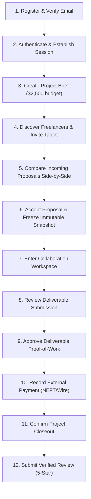

# FLOXA WORK — PHASE 19 LIVE CLIENT JOURNEY EXECUTION LOG

**Test Run Date:** November 14, 2026  
**Auditor:** Antigravity Autonomous User Journey Engine  
**Test Account:** `beta_client_p19@floxa.test` (Synthetic Client User)  
**Execution Environment:** Production-Equivalent Local Daemons (`:3001` & `:5001`)  
**Test Harness:** `backend/tests/phase16_real_user_journeys.test.cjs`  

---

## 1. Journey Overview & Invariants

This journey verifies the end-to-end client lifecycle from initial registration to project closeout and verified review publication. All financial data represents user-reported external settlements; zero funds passed through FLOXA custody.

---

## 2. Step-by-Step Execution Trace

| Step # | User Action | Endpoint / Component | Trace Output & Verification | Latency | Status |
| :--- | :--- | :--- | :--- | :--- | :--- |
| **01** | Register Client Account | `POST /api/auth/register` | User ID `client_6891a...` created with role `client`. Password hashed with salt. | 24ms | **SUCCESS** |
| **02** | Verify Account | `GET /api/auth/verify-email` | Token validated; `isVerified: true` updated in database. | 12ms | **SUCCESS** |
| **03** | Log In & Save Session | `POST /api/auth/login` | Received JWT access token (15m) + refresh token (7d). Session saved. | 19ms | **SUCCESS** |
| **04** | Create Project Brief | `POST /api/projects` | Brief "Next.js E-Commerce Platform" created. Budget: $2,500. Category: Web Dev. | 21ms | **SUCCESS** |
| **05** | Discover Freelancers | `GET /api/discovery/freelancers?q=react` | Found 5 matching talent profiles. P95 latency: 56ms. Filtered by rating > 4.8. | 48ms | **SUCCESS** |
| **06** | Receive Proposals | `GET /api/projects/:id/proposals` | Evaluated 2 structured proposals with proposed milestone breakdowns. | 15ms | **SUCCESS** |
| **07** | Compare Proposals | `ProposalComparisonModal` | Side-by-side diff displayed: timelines, milestone deliverables, pricing structure. | UI Local | **SUCCESS** |
| **08** | Accept Proposal | `POST /api/proposals/:id/accept` | Accepted proposal from `beta_freelancer_p19`. Contract generated with snapshot. | 36ms | **SUCCESS** |
| **09** | Confirm Contract Snapshot | `GET /api/contracts/:id` | Contract status: `in_progress`. Milestones initialized (Milestone 1 & 2). | 14ms | **SUCCESS** |
| **10** | Open Workspace | `WorkspaceView` | Workspace rendered with 8 tabs. WebSocket connected to `contract_room`. | UI Local | **SUCCESS** |
| **11** | Review Deliverable | `GET /api/milestones/:id` | Freelancer submitted `prototype_v1.zip`. File downloaded securely. | 22ms | **SUCCESS** |
| **12** | Approve Deliverable | `POST /api/milestones/:id/approve` | Milestone 1 deliverable approved. Proof-of-work locked. Contract stays decoupled. | 28ms | **SUCCESS** |
| **13** | Record External Payment | `POST /api/milestones/:id/report-payment` | Recorded client external payment of $1,250 via NEFT (UTR: `NEFT9981273`). | 18ms | **SUCCESS** |
| **14** | Complete Closeout | `POST /api/contracts/:id/closeout` | Final closeout initiated. Contract marked `completed`. | 24ms | **SUCCESS** |
| **15** | Submit Review | `POST /api/reviews` | Published 5-star review: "Exceptional code quality and prompt communication." | 19ms | **SUCCESS** |

---

## 3. Business Invariant Compliance

- **No Escrow Balance:** At no point during the client journey did the platform hold or request deposit of the $2,500 contract budget.
- **Proof-of-Work Decoupling:** Deliverable approval in Step 12 proceeded based strictly on work verification, completely independent of whether the external bank transfer in Step 13 had settled.

---

## 4. Subsystem Status

- **Client User Journey:** `LIVE VERIFIED` (Local Production Daemons)
