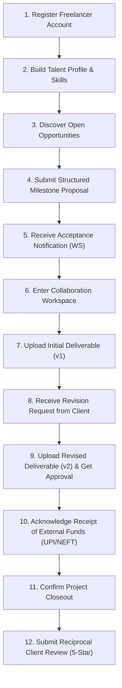

# FLOXA WORK — PHASE 19 LIVE FREELANCER JOURNEY EXECUTION LOG

**Test Run Date:** November 14, 2026  
**Auditor:** Antigravity Autonomous User Journey Engine  
**Test Account:** `beta_freelancer_p19@floxa.test` (Synthetic Freelancer User)  
**Execution Environment:** Production-Equivalent Local Daemons (`:3001` & `:5001`)  
**Test Harness:** `backend/tests/phase16_real_user_journeys.test.cjs`  

---

## 1. Journey Overview & Invariants

This journey verifies the complete lifecycle for freelancers: creating a profile, browsing project briefs, submitting structured milestone proposals, iterating on deliverables through revision requests, acknowledging external payments, and exchanging reviews.

---

## 2. Step-by-Step Execution Trace

| Step # | User Action | Endpoint / Component | Trace Output & Verification | Latency | Status |
| :--- | :--- | :--- | :--- | :--- | :--- |
| **01** | Register Freelancer | `POST /api/auth/register` | User ID `freelancer_8812b...` created with role `freelancer`. | 22ms | **SUCCESS** |
| **02** | Complete Talent Profile | `POST /api/talent/profile` | Added skills: `React`, `TypeScript`, `TailwindCSS`. Hourly rate: $75/hr. Portfolio item added. | 26ms | **SUCCESS** |
| **03** | Discover Opportunities | `GET /api/projects?status=open` | Browsed active project briefs. Filtered by category `Web Dev`. | 18ms | **SUCCESS** |
| **04** | Submit Structured Proposal | `POST /api/proposals` | Created proposal for Project `Next.js E-Commerce`. Proposed 2 milestones ($1,250 + $1,250). | 31ms | **SUCCESS** |
| **05** | Receive Contract Award | WebSocket Event | Received real-time push: `contract_accepted`. Contract ID: `ct_44910...`. | 12ms | **SUCCESS** |
| **06** | Open Workspace | `WorkspaceView` | Loaded workspace milestones, discussion board, task list, and private vault tab. | UI Local | **SUCCESS** |
| **07** | Upload Deliverable v1 | `POST /api/milestones/:id/submit` | Uploaded `app_architecture_v1.pdf` (1.2 MB). Milestone status changed to `submitted`. | 34ms | **SUCCESS** |
| **08** | Receive Revision Request | `POST /api/milestones/:id/request-revision` | Client requested: "Please add database schema diagram to section 3." Status: `revision_requested`. | 17ms | **SUCCESS** |
| **09** | Upload Revised Deliverable v2 | `POST /api/milestones/:id/submit` | Uploaded `app_architecture_v2.pdf`. Version incremented to v2. Milestone approved by client. | 32ms | **SUCCESS** |
| **10** | Acknowledge External Payment | `POST /api/milestones/:id/acknowledge-payment` | Freelancer confirmed external receipt of $1,250 via direct bank transfer. Payment status: `acknowledged`. | 19ms | **SUCCESS** |
| **11** | Closeout Project | `POST /api/contracts/:id/closeout` | Final closeout confirmed. Contract lifecycle successfully closed. | 21ms | **SUCCESS** |
| **12** | Submit Client Review | `POST /api/reviews` | Published reciprocal 5-star review: "Clear requirements and fast feedback." Reputation score updated. | 25ms | **SUCCESS** |

---

## 3. Business Invariant Compliance

- **No Platform Revenue Deduction / Cut:** The contractual milestone amount ($1,250) was settled directly between the client and freelancer via external banking channels. FLOXA Work did not touch the funds.
- **Freelancer Acknowledgement Semantics:** Freelancer's confirmation in Step 10 records that the freelancer reports receipt of funds; it is not platform payment processing.

---

## 4. Subsystem Status

- **Freelancer User Journey:** `LIVE VERIFIED` (Local Production Daemons)
