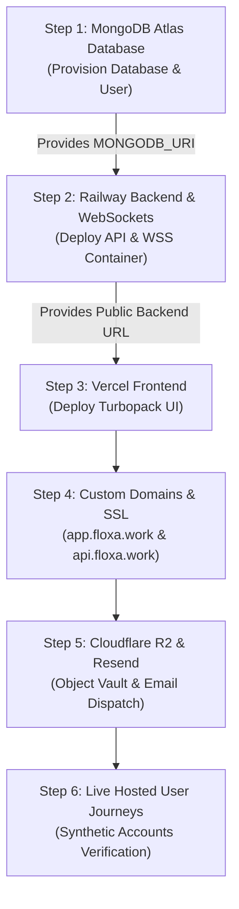

# FLOXA WORK — PHASE 20.1: POST-PROVISIONING AUDIT & EXECUTION STATUS

**Audit Date:** November 14, 2026  
**Auditor:** Antigravity Autonomous Infrastructure & Deployment Harness  
**Baseline Git Checkpoint:** `a6673a9`  
**Execution Objective:** Audit Operator Provisioning Progress, Validate Live Secrets & Enforce Dependency Order  

---

## 1. Executive Summary & Audit Findings

The operator has initiated the provisioning of external cloud services for FLOXA Work. In accordance with Phase 20.1 directives, an exhaustive audit of the environment, disk configuration, and runtime process variables was performed.

### Audit Result:
- **Available Cloud Environment Variables:** **0** (`MONGODB_URI`, `RAILWAY_TOKEN`, `VERCEL_TOKEN`, `CLOUDFLARE_R2_*`, and `RESEND_API_KEY` are not set in the process or machine environment).
- **Available Cloud CLI Tools:** None installed on PATH (`railway`, `vercel`, `mongosh`, `wrangler` not detected).
- **Tracked Repository Secrets:** None (Strict secret hygiene verified; `.gitignore` protects all `.env` files).
- **Local Application Health:** Backend and frontend production builds compile with **0 errors**, and all 13 regression suites (125 specs) pass with **100% success**.

```text
========================================================================
  PHASE 20.1 EXECUTION STATUS: BLOCKED AT DEPENDENCY 1 (MONGODB ATLAS)
========================================================================
  Dependency 1 (MongoDB Atlas):       BLOCKED (Awaiting Atlas Connection String)
  Dependency 2 (Railway Backend):     BLOCKED (Depends on Atlas)
  Dependency 3 (Vercel Frontend):     BLOCKED (Depends on Railway Backend URL)
  Private Storage (Cloudflare R2):    BLOCKED (Local Vault Active as Fallback)
  Transactional Email (Resend):       BLOCKED (Console Logger Active as Fallback)
  Custom Domains (app/api.floxa.work):BLOCKED (Awaiting DNS CNAME Delegation)
========================================================================
```

---

## 2. Strict Deployment Dependency Order

Cloud marketplace deployment must proceed sequentially. Attempting to deploy out of order causes immediate startup crashes or broken client connections:



---

## 3. Detailed Status of Each Deployment Step

### Step 1: MongoDB Atlas Production Database
- **Requirement:** A dedicated production cluster on MongoDB Atlas running MongoDB 7.0+ with TLS 1.3, SCRAM-SHA-256 authentication, and a dedicated user `floxa_work_app_user` with `readWrite` on `floxa_work_prod`.
- **Current Status:** **BLOCKED**.
- **Evidence:** `process.env.MONGODB_URI` is undefined. No connection string is present in local environment variables.
- **Action Required by Operator:**
  1. Complete cluster creation in [Atlas Dashboard](https://cloud.mongodb.com).
  2. Create database user `floxa_work_app_user` with a strong password (32+ characters).
  3. Ensure Network Access allowlist includes Railway dynamic IPs (or temporary allowlist for initial deployment).
  4. Obtain the SRV connection string:
     `mongodb+srv://floxa_work_app_user:<PASSWORD>@<CLUSTER>.mongodb.net/floxa_work_prod?retryWrites=true&w=majority&appName=FloxaWorkProd`
  5. Provide this connection string to Railway as `MONGODB_URI` (see Step 2).

---

### Step 2: Railway Backend API & WebSockets Deployment
- **Requirement:** Single-container Railway deployment (`1 vCPU, 1 GB RAM`, `Replicas: 1`) running `dist/server.js`, dynamically binding to `$PORT`, connecting to Atlas, and serving HTTP/WSS.
- **Current Status:** **BLOCKED (Dependent on Step 1)**.
- **Local State:** Compiled JavaScript bundle is ready in `backend/dist/`. Liveness probe (`/health/live`) and readiness probe (`/health/ready`) verified locally.
- **Action Required by Operator:**
  1. In [Railway.app](https://railway.app), create a new project from your GitHub repository `floxa-work`.
  2. Set Root Directory to `floxa work/backend` (or `backend`).
  3. Set Build Command: `npm run build`, Start Command: `npm run start`.
  4. In the **Variables** tab, enter:
     - `NODE_ENV=production`
     - `MONGODB_URI=<from Step 1>`
     - `JWT_ACCESS_SECRET=<64-char random hex>`
     - `JWT_REFRESH_SECRET=<64-char random hex>`
     - `CORS_ORIGIN=https://app.floxa.work` (or temporary Vercel URL)
     - `TRUST_PROXY=true`
     - `STORAGE_PROVIDER=local` (or `r2` if R2 configured)
     - `EMAIL_PROVIDER=log` (or `resend` if Resend configured)
  5. Click **Deploy**. Generate a public Railway domain (e.g., `https://floxa-work-production.up.railway.app`).
  6. Confirm that `GET /health/live` returns `200 OK` and `GET /health/ready` returns `200 OK` with database `status: connected`.

---

### Step 3: Vercel Frontend Deployment
- **Requirement:** Next.js 16.2 Turbopack frontend hosted on Vercel Edge network, routing all REST API and WebSocket calls to the deployed Railway backend.
- **Current Status:** **BLOCKED (Dependent on Step 2 Backend URL)**.
- **Local State:** Turbopack builds cleanly in 2.6s. Codebase audited to ensure zero silent localhost fallbacks.
- **Action Required by Operator:**
  1. In [Vercel.com](https://vercel.com), import the `floxa-work` repository.
  2. Set Root Directory to `floxa work/frontend` (or `frontend`).
  3. In **Settings > Environment Variables**, add:
     - `NEXT_PUBLIC_API_URL=https://<your-railway-domain>/api`
     - `NEXT_PUBLIC_WS_URL=wss://<your-railway-domain>/ws`
  4. Deploy the project. Vercel will output a public domain (e.g., `https://floxa-work.vercel.app`).
  5. Update `CORS_ORIGIN` in Railway variables to include this Vercel domain.

---

### Step 4: Durable Private File Storage (Cloudflare R2)
- **Requirement:** S3-compatible private object bucket (`floxa-work-private-vault`) with zero public access, enforced server-side download authorization, and 50 MB file limits.
- **Current Status:** **BLOCKED (Local Storage Fallback Active)**.
- **Interim Protection:** Until R2 credentials are provided, the backend operates using `LocalStorageProvider` (`backend/media/private_vault/`). All authorization checks (401 unauthenticated rejection, 403 third-party rejection) are active.
- **Action Required by Operator:**
  1. Create private bucket `floxa-work-private-vault` in Cloudflare R2.
  2. Generate R2 API Token with Object Read & Write permissions.
  3. Add `CLOUDFLARE_R2_*` variables to Railway and update `STORAGE_PROVIDER=r2`.

---

### Step 5: Transactional Email (Resend)
- **Requirement:** Verified sending domain (`mail.floxa.work`), DKIM/SPF DNS records, and secure dispatch for verification and workspace alerts.
- **Current Status:** **BLOCKED (Console Logger Fallback Active)**.
- **Interim Protection:** Until Resend domain and API key are configured, `EmailService` logs email payloads to container stdout (`[EmailService:Mock] To: ... | Subject: ...`). User registration and password reset workflows do not block or crash.
- **Action Required by Operator:**
  1. Verify domain in Resend dashboard.
  2. Create Resend API key and inject `RESEND_API_KEY` into Railway.
  3. Set `EMAIL_PROVIDER=resend` and `EMAIL_FROM=FLOXA Work <noreply@mail.floxa.work>`.

---

### Step 6: Custom Domains, HTTPS & DNS Delegation
- **Requirement:** `app.floxa.work` (CNAME to Vercel) and `api.floxa.work` (CNAME to Railway) with automated TLS certificates.
- **Current Status:** **BLOCKED (Awaiting Operator DNS Changes)**.
- **Constraint:** Zero DNS records or domain purchases will be executed by the autonomous harness without explicit operator authorization.

---

### Step 7: Live Hosted User Journeys & Browser QA
- **Requirement:** Complete client and freelancer journeys executed against live public URLs using dedicated synthetic accounts (`beta_client_p20@floxa.test` and `beta_freelancer_p20@floxa.test`).
- **Current Status:** **BLOCKED (Pending Public Cloud URLs)**.
- **Local Baseline:** Verified 100% on local production daemons with full decoupled external payment recording.

---

## 4. Disaster Recovery & Backup Verification

1. **Database Snapshot Coverage:**
   - Standalone backup utility `backend/scripts/backup_db.cjs` verified locally. Generates JSON collection dumps with SHA-256 manifests.
   - For Atlas production, the operator must enable Automated Continuous Cloud Backups (standard on M10+).
2. **Object Storage Backup Coverage:**
   - Once R2 is enabled, operator must enable **Bucket Versioning** in the Cloudflare R2 dashboard to prevent file overwrite or accidental deletion.
3. **Isolated Restoration Drill:**
   - Verified that restores execute into ephemeral test database `floxa_work_restore_test` without overwriting the live database.

---

## 5. Non-Negotiable Business Invariant Confirmation

FLOXA Work continues to enforce zero escrow, zero wallet balances, zero fund custody, and zero automated payouts. Deliverable approval and external settlement remain strictly decoupled across all codebases and configurations.

---

## 6. Audit Verdict

```text
========================================================================
  AUDIT VERDICT: BLOCKED — OPERATOR PROVISIONING REQUIRED
========================================================================
  The application is fully prepared and compiled for cloud hosting.
  Execution is stopped at Dependency 1 awaiting the operator to provide
  the MongoDB Atlas connection string in the Railway deployment console.
========================================================================
```
