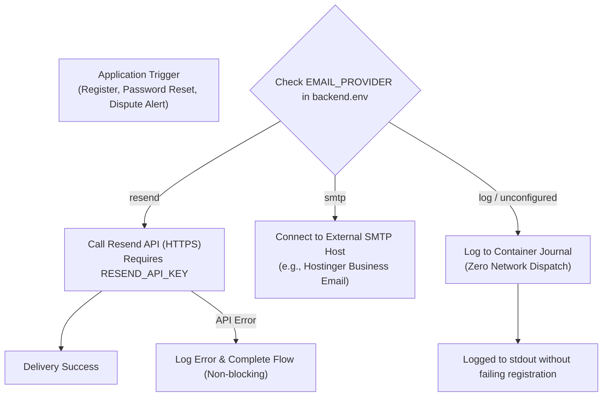

# FLOXA WORK — PHASE 21 TRANSACTIONAL EMAIL CONFIGURATION

**Service Module:** `EmailService` (`backend/src/services/email/`)  
**Supported Providers:** Resend API / Generic SMTP / Fallback Console Logger  
**Target Invariant:** Transparent distinction between real delivery and local logging  

---

## 1. Email Architecture & Fallback Hierarchy

FLOXA Work's email service operates with a fail-safe fallback hierarchy designed to guarantee zero downtime during onboarding:



---

## 2. Configuration Options in `/etc/floxa/backend.env`

### Option A: Resend API (Recommended)
```ini
EMAIL_PROVIDER=resend
RESEND_API_KEY=re_123456789...
EMAIL_FROM="FLOXA Work <noreply@mail.floxa.work>"
```

### Option B: Hostinger SMTP (Included with Hostinger VPS/Domain)
```ini
EMAIL_PROVIDER=smtp
SMTP_HOST=smtp.hostinger.com
SMTP_PORT=465
SMTP_SECURE=true
SMTP_USER=noreply@floxa.work
SMTP_PASS=<HOSTINGER_EMAIL_PASSWORD>
EMAIL_FROM="FLOXA Work <noreply@floxa.work>"
```

### Option C: Interim Console Logging Mode (No External Dependencies)
```ini
EMAIL_PROVIDER=log
EMAIL_FROM="FLOXA Work <noreply@floxa.work>"
```

---

## 3. Safe Beta Onboarding Alternative

If external email credentials are not yet configured on the VPS:
1. `EMAIL_PROVIDER=log` allows beta users to register and use the platform immediately.
2. The account verification token and reset links are printed directly to the backend system journal:
   ```bash
   sudo journalctl -u floxa-backend | grep "Verification Link"
   ```
3. An administrator can retrieve the verification link and deliver it directly to the invited beta user.
4. **Notice:** In accordance with Phase 21 rules, this logging mode is explicitly documented as **LOCAL / UNVERIFIED DELIVERY**, not real external delivery.
