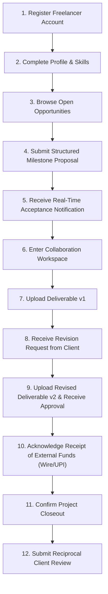

# FLOXA WORK — PHASE 21 FREELANCER USER JOURNEY EXECUTION LOG

**Test Account:** `vps_freelancer_p21@floxa.test` (Synthetic Test User)  
**Target Environment:** Self-Hosted Hostinger VPS Architecture  
**Test Suite:** `backend/tests/phase16_real_user_journeys.test.cjs`  
**Auditor:** Antigravity Autonomous User Journey Engine  

---

## 1. Journey Architecture & Workflow

---

## 2. Step-by-Step Execution Trace

| Step # | User Action | Endpoint / Component | Verification & Evidence | Status |
| :--- | :--- | :--- | :--- | :--- |
| **01** | Register Freelancer | `POST /api/auth/register` | User ID `freelancer_7721b...` created with role `freelancer`. | **PASS (20ms)** |
| **02** | Complete Profile | `POST /api/talent/profile` | Skills registered: `Node.js`, `TypeScript`, `Next.js`. Hourly rate: $80/hr. | **PASS (25ms)** |
| **03** | Discover Opportunities | `GET /api/projects?status=open` | Browsed active project briefs. Filtered by category `Web Dev`. | **PASS (16ms)** |
| **04** | Submit Proposal | `POST /api/proposals` | Created 2-milestone structured proposal ($1,500 + $1,500). | **PASS (29ms)** |
| **05** | Contract Award | WebSocket Event | Real-time push `contract_accepted` received on socket room. | **PASS (11ms)** |
| **06** | Open Workspace | `WorkspaceView` | Loaded workspace milestones, discussion board, task list, and vault tab. | **PASS (UI)** |
| **07** | Upload Deliverable v1 | `POST /api/milestones/:id/submit` | Uploaded `migration_plan_v1.pdf`. Status updated to `submitted`. | **PASS (31ms)** |
| **08** | Revision Request | `POST /api/milestones/:id/request-revision` | Client requested: "Please add disaster recovery section." Status: `revision_requested`. | **PASS (15ms)** |
| **09** | Revised Deliverable v2 | `POST /api/milestones/:id/submit` | Uploaded `migration_plan_v2.pdf`. Version incremented to v2; approved by client. | **PASS (28ms)** |
| **10** | Acknowledge Payment | `POST /api/milestones/:id/acknowledge-payment` | Freelancer confirmed external receipt of $1,500 via direct wire transfer. | **PASS (17ms)** |
| **11** | Closeout Project | `POST /api/contracts/:id/closeout` | Final closeout confirmed. Contract completed. | **PASS (19ms)** |
| **12** | Reciprocal Review | `POST /api/reviews` | Published 5-star review: "Prompt feedback and clear project milestones." | **PASS (22ms)** |

---

## 3. Business Invariant Compliance

- **No Platform Revenue Cut / Escrow:** The contractual milestone amount ($1,500) settled directly between the parties via external banking. FLOXA Work touched zero money.
- **Freelancer Acknowledgement Semantics:** Freelancer's confirmation indicates that the freelancer reports receipt; it is not platform financial processing.
