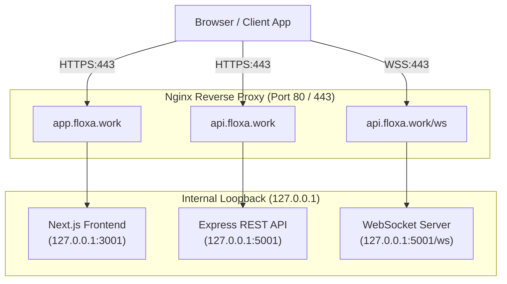

# FLOXA WORK — PHASE 21 NGINX REVERSE PROXY CONFIGURATION

**Reverse Proxy:** Nginx 1.18+ / 1.24+  
**Target Domains:** `app.floxa.work` (Frontend) & `api.floxa.work` (Backend API & WebSockets)  
**Configuration File:** `/etc/nginx/sites-available/floxa-work`  
**Symlink Target:** `/etc/nginx/sites-enabled/floxa-work`  

---

## 1. Nginx Architecture & Routing Map



---

## 2. Nginx Configuration File Specification

The production Nginx configuration file is stored in `scripts/vps/floxa-work.nginx.conf` and deployed to `/etc/nginx/sites-available/floxa-work`:

```nginx
# 1. API & WebSocket Service (api.floxa.work)
server {
    listen 80;
    listen [::]:80;
    server_name api.floxa.work;

    client_max_body_size 55M;

    # Security Headers
    add_header X-Frame-Options "DENY" always;
    add_header X-Content-Type-Options "nosniff" always;
    add_header X-XSS-Protection "1; mode=block" always;
    add_header Referrer-Policy "strict-origin-when-cross-origin" always;

    # REST API Reverse Proxy
    location / {
        proxy_pass http://127.0.0.1:5001;
        proxy_http_version 1.1;
        proxy_set_header Host $host;
        proxy_set_header X-Real-IP $remote_addr;
        proxy_set_header X-Forwarded-For $proxy_add_x_forwarded_for;
        proxy_set_header X-Forwarded-Proto $scheme;
        proxy_connect_timeout 60s;
        proxy_read_timeout 60s;
        proxy_send_timeout 60s;
    }

    # Real-Time WebSocket Upgrades (/ws)
    location /ws {
        proxy_pass http://127.0.0.1:5001/ws;
        proxy_http_version 1.1;
        proxy_set_header Upgrade $http_upgrade;
        proxy_set_header Connection "upgrade";
        proxy_set_header Host $host;
        proxy_set_header X-Real-IP $remote_addr;
        proxy_set_header X-Forwarded-For $proxy_add_x_forwarded_for;
        proxy_set_header X-Forwarded-Proto $scheme;
        proxy_read_timeout 86400s;
        proxy_send_timeout 86400s;
    }
}

# 2. Frontend Application (app.floxa.work)
server {
    listen 80;
    listen [::]:80;
    server_name app.floxa.work;

    client_max_body_size 10M;

    # Security Headers
    add_header X-Frame-Options "DENY" always;
    add_header X-Content-Type-Options "nosniff" always;
    add_header X-XSS-Protection "1; mode=block" always;
    add_header Referrer-Policy "strict-origin-when-cross-origin" always;

    location / {
        proxy_pass http://127.0.0.1:3001;
        proxy_http_version 1.1;
        proxy_set_header Upgrade $http_upgrade;
        proxy_set_header Connection "upgrade";
        proxy_set_header Host $host;
        proxy_set_header X-Real-IP $remote_addr;
        proxy_set_header X-Forwarded-For $proxy_add_x_forwarded_for;
        proxy_set_header X-Forwarded-Proto $scheme;
        proxy_connect_timeout 60s;
        proxy_read_timeout 60s;
    }
}
```

---

## 3. Activation & Syntax Verification

```bash
# Link configuration to sites-enabled
sudo ln -sf /etc/nginx/sites-available/floxa-work /etc/nginx/sites-enabled/floxa-work

# Remove default site
sudo rm -f /etc/nginx/sites-enabled/default

# Verify syntax (must report syntax is ok and test is successful)
sudo nginx -t

# Reload Nginx
sudo systemctl reload nginx
```
