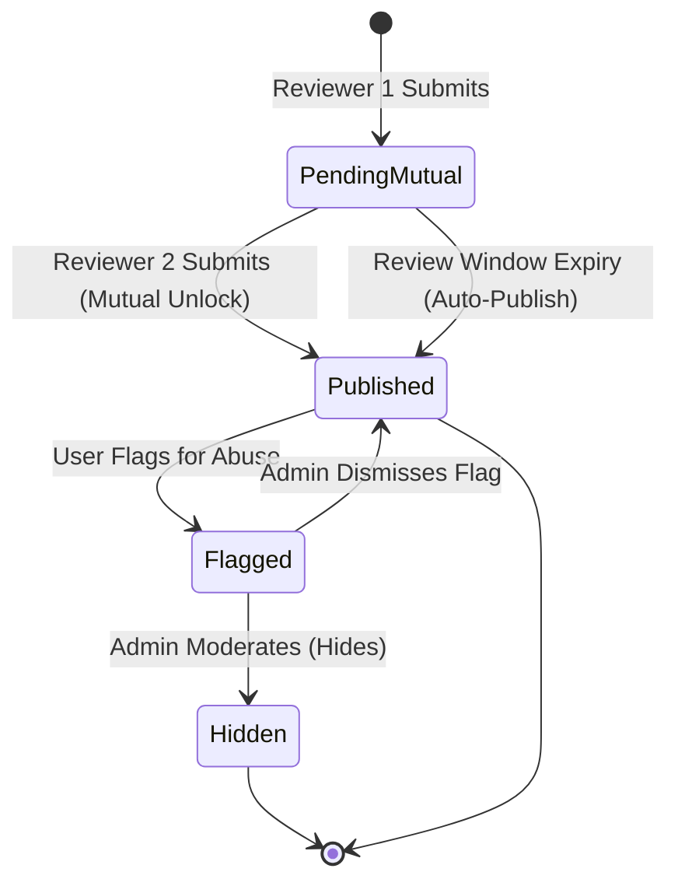

# FLOXA WORK — REVIEW ELIGIBILITY AND PUBLICATION POLICY
## Double-Blind Mutual Publishing and Abuse Prevention Standards

**Version:** 1.0.0  
**Date:** 14 November 2026  
**Status:** Production Standard  

---

## 1. Review Eligibility Preconditions

A user is strictly eligible to submit a review if and only if ALL of the following criteria are satisfied:
1. **Authenticated Session:** User is logged in with valid JWT token.
2. **Contract Participation:** User's ID matches either `contract.clientId` or `contract.freelancerId`. Non-participants receive HTTP `403 Forbidden`.
3. **Completed Contract State:** `contract.status === 'completed'`. Contracts in `active`, `disputed`, or `cancelled` status reject review attempts with HTTP `400 Bad Request`.
4. **Dual Closeout Confirmation:** Project closeout has been formally recorded (`closeoutStatus === 'completed'`).
5. **No Prior Review:** The user has not previously submitted a review for this contract (`{ contractId, reviewerId }` uniqueness).

---

## 2. Double-Blind Publication Lifecycle

### 2.1 Confidential Holding (`pending_mutual`)
When the first participant submits their review:
- The review record is created with `status = 'pending_mutual'`.
- Counterpart receives a notification that a review was submitted, but **CANNOT** read the score or textual review content.
- The review is not included in the target user's public rating calculations.

### 2.2 Mutual Unlock Transition (`published`)
When the second participant submits their review:
- Both reviews immediately transition to `status = 'published'` with `publishedAt = new Date()`.
- Reputation recalculation is automatically executed for both target profiles.
- Both users receive real-time notifications that mutual reviews are now publicly readable.

### 2.3 Window Expiration Auto-Publish
If only one party submits a review and the allowed submission period expires (or via admin/system publish), the single review transitions to `published` to prevent an uncooperative party from permanently suppressing authentic feedback.

---

## 3. Rating Dimensions

Reviews require rating scores from 1 to 5 (inclusive) across five discrete dimensions:
1. **Overall Satisfaction (1.0 to 5.0):** Holistic project execution assessment.
2. **Communication (1.0 to 5.0):** Responsiveness, clarity, and constructive problem-solving.
3. **Quality of Work (1.0 to 5.0):** Craft excellence, attention to detail, adherence to standards.
4. **Reliability (1.0 to 5.0):** Punctuality, meeting agreed milestones, predictability.
5. **Professionalism (1.0 to 5.0):** Respectful conduct, ethics, and partnership integrity.
