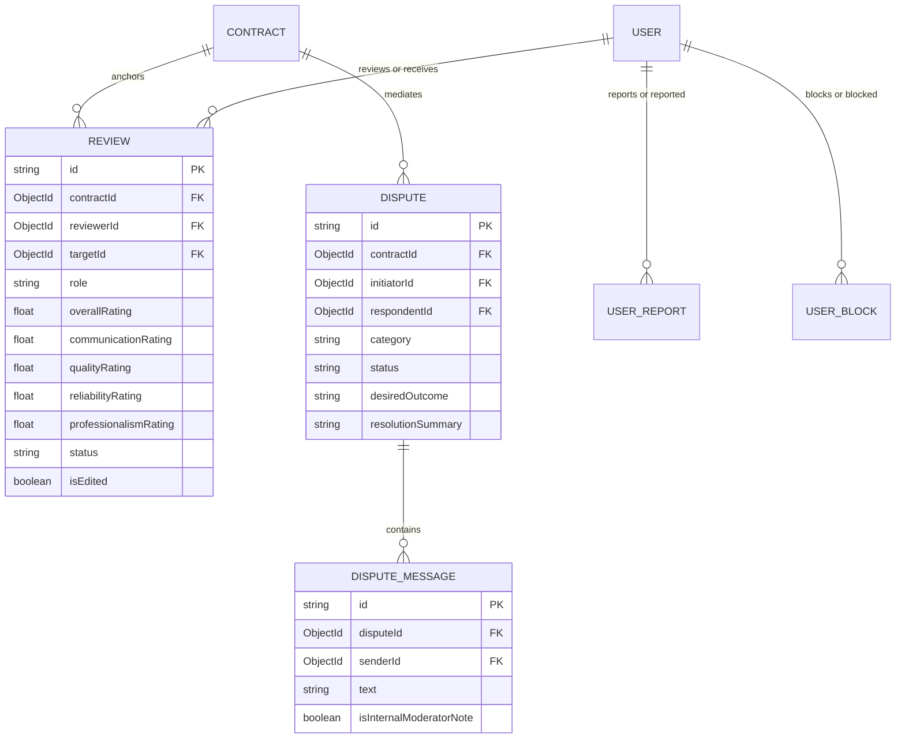

# FLOXA WORK — TRUST AND REPUTATION ARCHITECTURE
## Cryptographically Anchored, Abuse-Resistant Social Reputation Infrastructure

**Version:** 1.0.0  
**Date:** 14 November 2026  
**Status:** Production Standard  

---

## 1. Architectural Philosophy

Traditional freelance marketplaces suffer from severe reputation distortion:
- **Retaliatory Ratings:** Parties give bad reviews out of fear of or in response to critical feedback.
- **Unverified Feedback:** Anyone can review anyone without an actual financial and deliverable contract.
- **Subjective Ambiguity:** A single overall star score hides crucial dimensions like reliability, speed, and communication.
- **Escrow-Compelled Reviews:** Review systems are frequently chained to automatic escrow release mechanisms.

FLOXA Work's trust architecture solves these challenges through:
1. **Contract-Anchored Eligibility:** Reviews can ONLY be submitted by participants on contracts with `status === 'completed'` and confirmed dual-party closeout.
2. **Double-Blind Holding Period:** Reviews remain confidential (`pending_mutual`) until both parties submit or the window expires.
3. **Multi-Dimensional Evaluation:** Disaggregated sub-scores across Communication, Quality of Work, Reliability, and Professionalism.
4. **Decoupled Non-Custodial Architecture:** Reputation is completely independent of money custody.

---

## 2. System Entity Relationship Model

---

## 3. Data Integrity Invariants

1. **Unique Review Constraint:** `{ contractId: 1, reviewerId: 1 }` is unique. A reviewer cannot submit duplicate reviews for the same contract.
2. **Self-Review Immunity:** A participant cannot review themselves (`reviewerId !== targetId`).
3. **Unpublished Review Exclusion:** Reviews with status `pending_mutual`, `flagged`, or `hidden` are strictly omitted from public profile calculations.
4. **Permanent Direct Billing:** No reputation metric, dispute resolution, or review action triggers or reverses monetary transactions on the platform.
