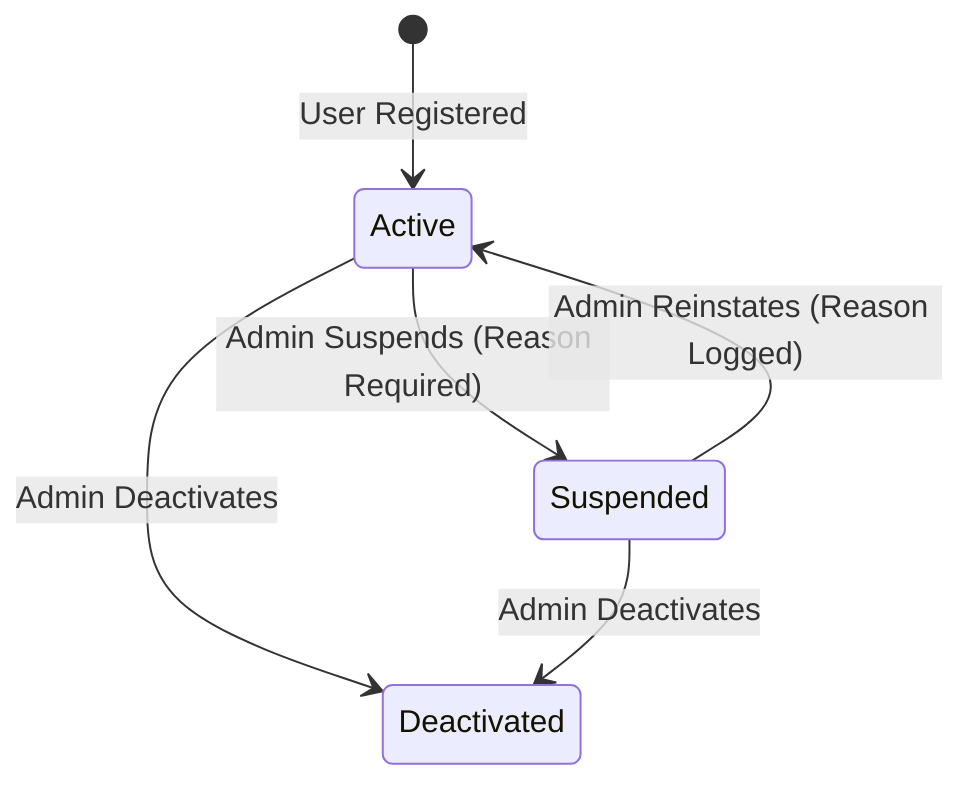

# FLOXA Work — User Administration & Account Lifecycle Workflow

**Module:** Administrative User Management & Compliance Enforcement  
**Routes:** `GET /api/admin/users`, `GET /api/admin/users/:userId`, `PUT /api/admin/users/:userId/status`, `PUT /api/admin/users/:userId/restrictions`  
**Security Tier:** `users:view`, `users:manage`, `users:restrict`  
**Date:** 14 November 2026  

---

## 1. User Administration Architecture

FLOXA Work user administration guarantees strict privacy controls, credential protection, and verifiable accountability for all administrative interventions.

### Safe Credential Projection
Whenever administrative endpoints query or search user accounts, sensitive security credentials are strictly excluded at the MongoDB projection layer:
```typescript
.select('-passwordHash -passwordResetTokenHash -emailVerificationTokenHash -refreshTokenFamily')
```
Zero password hashes or cryptographic secrets are ever serialized over HTTP or rendered in administrative browser panels.

---

## 2. Account Suspension Lifecycle

To protect marketplace integrity against bad actors, fraud, or terms-of-service violations, authorized administrators can suspend accounts.



### Suspension Requirements
1. **Mandatory Administrative Reason:** A non-empty explanation (`reason`) must be provided. Requests lacking a reason are rejected with `HTTP 400 Bad Request`.
2. **Immediate Login Barrier:** When `user.status === 'suspended'`, `auth.controller.ts` blocks all authentication attempts with `HTTP 403 Forbidden` and surfaces the specific administrative suspension notice.
3. **Session Invalidation:** All active refresh token families for the suspended user are instantly revoked.
4. **Audit Trail Generation:** An immutable audit log entry (`USER_SUSPENDED`) records the acting administrator's ID, the target user ID, timestamp, and justification.

---

## 3. Communication & Marketplace Restrictions

For minor policy violations or pending dispute investigations, moderators can apply granular restrictions without fully suspending login access:
- **`messagingRestricted`:** Blocks the user from initiating or replying to private chat messages.
- **`invitationsRestricted`:** Blocks the user from receiving or sending direct project invitations.

Both restrictions are logged in the platform audit trail and can be lifted independently upon resolution.

